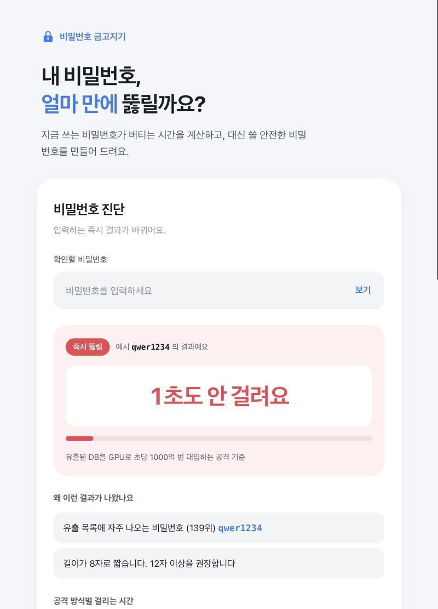
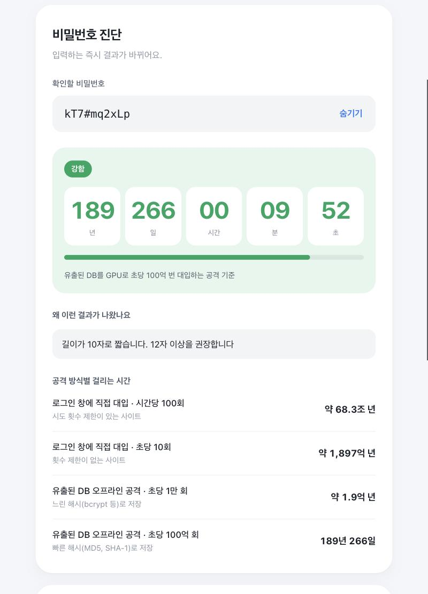
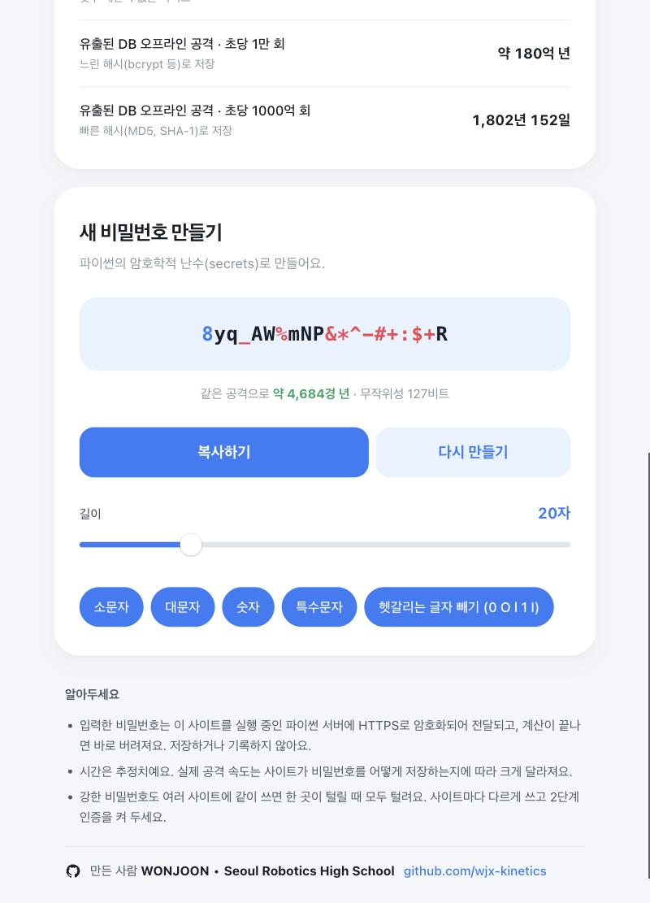

# 비밀번호 금고지기

**한국어** | [English (영문 저장소)](https://github.com/wjx-kinetics/password-site-en)

[](https://github.com/wjx-kinetics/password-site/actions/workflows/tests.yml)

지금 쓰는 비밀번호가 공격자에게 얼마 만에 뚫리는지 계산해 보여 주고, 대신 쓸 안전한 비밀번호를 만들어 주는 웹사이트입니다. 파이썬(Flask)으로 만들었고 HTTPS로 접속합니다.

| 약한 비밀번호 | 강한 비밀번호 | 새 비밀번호 만들기 |
|---|---|---|
|  |  |  |

## 발표 자료

- [발표 자료 (PDF)](docs/presentation-ko.pdf)
- 영문판은 [영문 저장소](https://github.com/wjx-kinetics/password-site-en)에 있습니다.

## 만든 이유

비밀번호 유출 사고가 계속 일어나지만, 내 비밀번호가 실제로 얼마나 약한지는 체감하기 어렵습니다. "8자 이상, 특수문자 포함" 같은 규칙만 지킨 `qwer1234!` 같은 비밀번호는 규칙은 통과해도 1초 안에 뚫립니다. 이 사이트는 그 사실을 년·일·시간·분·초 단위의 시간으로 바꿔서 보여 줍니다.

## 기능

**비밀번호 진단**
- 입력하는 즉시 뚫리는 데 걸리는 시간을 년·일·시간·분·초로 표시합니다.
- 왜 약한지 이유를 알려 줍니다. (유출 목록에 있는 비밀번호, 키보드 배열, 날짜, 반복, 사전 단어 등)
- 한국 사용자가 자주 쓰는 방식도 잡아냅니다. 예를 들어 `dkssud`(안녕), `tkfkdgo`(사랑해)처럼 한글 단어를 영문 자판으로 친 것을 인식합니다.
- 공격 방식 4가지에 대해 각각 걸리는 시간을 보여 줍니다.

**새 비밀번호 만들기**
- 길이 8~64자, 소문자·대문자·숫자·특수문자를 골라서 만들 수 있습니다.
- `0`과 `O`, `l`과 `1`처럼 헷갈리는 글자를 뺄 수 있습니다.
- 만든 비밀번호가 같은 공격에 얼마나 버티는지 함께 표시합니다.

## 실행 방법

파이썬 3.9 이상이 필요합니다. 없으면 [python.org](https://www.python.org/downloads/)에서 설치합니다. 윈도우는 설치 첫 화면에서 **Add python.exe to PATH**를 꼭 체크합니다.

### 1. 내려받기

이 페이지 위쪽의 초록색 **Code** 버튼 → **Download ZIP**을 눌러 받은 뒤 압축을 풉니다. git을 쓴다면 다음 명령으로 받아도 됩니다.

```
git clone https://github.com/wjx-kinetics/password-site.git
```

### 2. 실행하기

**윈도우**: 폴더 안의 `run.bat`을 더블클릭합니다.

**맥 / 리눅스**: 터미널에서 폴더로 이동한 뒤 다음을 실행합니다.

```
sh run.sh
```

처음 실행할 때만 필요한 패키지를 설치하느라 1분쯤 걸립니다. 준비가 끝나면 브라우저가 자동으로 `https://localhost:8443`을 엽니다.

### 3. 브라우저 경고 넘기기

이 사이트는 직접 만든 인증서(자체 서명 인증서)를 쓰기 때문에 처음 열 때 "연결이 비공개로 설정되어 있지 않습니다" 같은 경고가 나옵니다. **고급 → localhost(안전하지 않음)(으)로 이동**을 누르면 됩니다. 통신은 정상적으로 암호화됩니다.

### 끄는 방법

실행 중인 검은 창(터미널)에서 `Ctrl + C`를 누르거나 창을 닫습니다.

### 실행 옵션

| 명령 | 설명 |
|---|---|
| `run.bat --lan` / `sh run.sh --lan` | 같은 Wi-Fi에 있는 휴대폰이나 다른 컴퓨터에서도 접속할 수 있게 합니다. |
| `--port 9000` | 8443 대신 다른 포트를 씁니다. |
| `--no-browser` | 브라우저를 자동으로 열지 않습니다. |

### 스크립트 없이 직접 실행하기

```
python -m venv .venv
.venv\Scripts\pip install -r requirements.txt      (윈도우)
.venv/bin/pip install -r requirements.txt          (맥 / 리눅스)
.venv\Scripts\python app.py                        (윈도우)
.venv/bin/python app.py                            (맥 / 리눅스)
```

## 동작 원리

### 뚫리는 시간은 어떻게 계산하는가

```
걸리는 시간 = 공격자가 맞힐 때까지 시도해야 하는 횟수 ÷ 초당 시도 횟수
```

**시도 횟수 추정**

공격자는 모든 조합을 처음부터 넣어 보지 않습니다. 유출된 비밀번호 목록, 사전 단어, 키보드 배열, 날짜처럼 사람들이 자주 쓰는 것부터 넣어 봅니다. 그래서 글자 수와 종류만 세면 실제보다 훨씬 강하게 나옵니다.

이 사이트는 Dropbox가 만든 `zxcvbn` 알고리즘으로 비밀번호를 조각으로 나누고, 조각마다 공격자가 몇 번째쯤에 시도할지를 추정합니다.

| 찾아내는 패턴 | 예 |
|---|---|
| 유출 목록에 있는 비밀번호 | `password`, `qwer1234` |
| 사전 단어, 흔한 이름 | `summer`, `michael` |
| 글자 바꿔치기 | `P@ssw0rd` |
| 키보드 배열 | `qwerty`, `1q2w3e4r` |
| 연속, 반복 | `abcd`, `1234`, `aaaa` |
| 날짜, 연도 | `2024`, `19990101` |
| 한국어 단어 (직접 추가) | `dkssud`, `안녕하세요` |

어떤 패턴에도 해당하지 않는 무작위 구간은 `문자 종류 수 ^ 글자 수`로 계산합니다. 문자 종류 수는 소문자 26, 대문자 26, 숫자 10, 특수문자 33, 한글 2350을 사용한 것만 더합니다.

**초당 시도 횟수**

같은 비밀번호라도 공격 상황에 따라 속도가 크게 다릅니다. 화면의 큰 시계는 가장 불리한 마지막 경우를 기준으로 합니다.

| 공격 방식 | 속도 |
|---|---|
| 로그인 창에 직접 대입 (횟수 제한 있음) | 시간당 100회 |
| 로그인 창에 직접 대입 (횟수 제한 없음) | 초당 10회 |
| 유출된 DB 오프라인 공격, 느린 해시(bcrypt 등) | 초당 1만 회 |
| 유출된 DB 오프라인 공격, 빠른 해시(MD5, SHA-1) | 초당 1000억 회 |

**초당 1000억 회의 근거**

처음에는 `zxcvbn`이 가정하는 초당 100억 회를 썼습니다. 이 값이 맞는지 확인하려고, 비밀번호 해독 전문가들이 표준 도구인 hashcat으로 측정해 공개한 속도와 비교하였습니다.

| 공개된 측정 사례 | MD5 | SHA-1 |
|---|---|---|
| Jeremi Gosney의 25-GPU 클러스터 (2012, Passwords^12 학회 발표) | 초당 1800억 | 초당 630억 |
| RTX 3090 한 장, hashcat 벤치마크 (2020) | 초당 651억 | 초당 228억 |
| RTX 4090 한 장, hashcat 벤치마크 (2022) | 초당 1641억 | 초당 506억 |
| RTX 5090 한 장, hashcat 벤치마크 (2025) | 초당 2206억 | 초당 702억 |
| **평균** | **초당 1574억** | **초당 517억** |

여덟 수치의 평균은 초당 1046억 회입니다. 기존 값이 약 10배 낮았으므로 초당 1000억 회로 바꾸었습니다. 그 결과 무작위 10자 비밀번호(`kT7#mq2xLp`)는 189년에서 19년으로 줄어 "보통"이 되었고, 한 글자를 더한 11자(`kT7#mq2xLp9`)는 1802년으로 "강함"입니다.

이 값이 다루지 못하는 범위는 다음과 같습니다.

- 네 사례 중 셋은 그래픽카드 한 장 기준입니다. 카드를 열 장 쓰는 공격자는 열 배 빠릅니다.
- 더 빠른 해시도 있습니다. 윈도우가 쓰는 NTLM은 RTX 5090 한 장에서 초당 3401억 회입니다.
- 느린 해시는 훨씬 느립니다. bcrypt는 RTX 4090에서 반복 32회 기준 초당 18만 4천 회이고, 현실적인 설정인 반복 1024회로 환산하면 초당 약 5750회입니다(직접 계산). 사이트의 "느린 해시" 줄은 초당 1만 회를 씁니다.

출처: Chick3nman의 hashcat 벤치마크([RTX 3090](https://gist.github.com/Chick3nman/e4fcee00cb6d82874dace72106d73fef), [RTX 4090](https://gist.github.com/Chick3nman/32e662a5bb63bc4f51b847bb422222fd), [RTX 5090](https://gist.github.com/Chick3nman/09bac0775e6393468c2925c1e1363d5c)), [Infosecurity Magazine의 2012년 클러스터 보도](https://www.infosecurity-magazine.com/news/gpu-cluster-can-crack-any-ntlm-8-character-hashed)

**판정 기준** (초당 1000억 회 공격 기준)

| 걸리는 시간 | 판정 |
|---|---|
| 1분 미만 | 즉시 뚫림 |
| 1일 미만 | 매우 약함 |
| 1년 미만 | 약함 |
| 100년 미만 | 보통 |
| 100년 이상 | 강함 |

### 비밀번호는 어떻게 만드는가

파이썬 표준 라이브러리의 `secrets` 모듈을 씁니다. 일반 난수(`random`)는 다음 값을 예측할 수 있어서 비밀번호에 쓰면 안 되고, `secrets`는 운영체제가 제공하는 암호학적 난수를 사용합니다. 고른 문자 종류가 하나씩은 반드시 들어가도록, 조건에 맞을 때까지 다시 뽑습니다.

무작위성은 `길이 × log2(문자 종류 수)` 비트로 표시합니다. 기본 설정(20자, 81종)은 약 127비트입니다.

### 전체 구조

```
브라우저 (static/)                     파이썬 서버 (app.py)
┌──────────────────┐   HTTPS    ┌──────────────────────────┐
│ 입력창, 시계 화면 │ ─────────> │ /api/check    비밀번호 진단 │
│ 결과를 그리기만 함 │ <───────── │ /api/generate 비밀번호 생성 │
└──────────────────┘    JSON    └──────────────────────────┘
```

계산은 모두 파이썬 서버가 하고, 브라우저의 자바스크립트는 받은 결과를 화면에 그리기만 합니다.

### 보안을 위해 한 것

- **HTTPS**: 처음 실행할 때 인증서를 자동으로 만들어 `certs/` 폴더에 보관합니다. 비밀번호가 암호화되지 않은 채로 전달되지 않습니다.
- **저장하지 않음**: 입력된 비밀번호는 계산에만 쓰고 파일이나 기록에 남기지 않습니다.
- **외부 요청 없음**: 글꼴이나 스크립트를 다른 서버에서 받아 오지 않습니다. 보안 헤더(CSP)로 외부 코드 실행도 막았습니다.
- **요청 제한**: 한 사람이 10초에 150번을 넘게 요청하면 잠시 막습니다.
- **기본은 내 컴퓨터 전용**: `--lan` 옵션을 주지 않으면 다른 기기에서 접속할 수 없습니다.

## 실제 데이터로 확인한 결과

사이트의 판정이 현실과 맞는지 확인하려고, 예시 비밀번호를 [Pwned Passwords](https://haveibeenpwned.com/Passwords)에서 조회하였습니다. 실제 유출 사고에서 나온 비밀번호를 모아 둔 공개 자료입니다. 조회에는 해시의 앞 5글자만 보내는 범위 조회 방식을 썼습니다. 횟수는 2026년 11월 26일 기준입니다.

| 비밀번호 | 실제 유출에서 발견된 횟수 | 이 사이트의 판정 |
|---|---|---|
| `password` | 52,373,976 | 즉시 뚫림 |
| `P@ssw0rd` | 6,421,554 | 즉시 뚫림 |
| `qwer1234` | 3,436,774 | 즉시 뚫림 |
| `qwer1234!` | 48,084 | 즉시 뚫림 |
| `tkfkdgo` (사랑해) | 174,486 | 즉시 뚫림 |
| `dkssud` (안녕) | 24,239 | 즉시 뚫림 |
| `qlalfqjsgh` (비밀번호) | 15,976 | 즉시 뚫림 |
| `dkssud12!` | 3,824 | 즉시 뚫림 |
| `kT7#mq2xLp` (무작위 10자) | 0 | 보통 |
| `kT7#mq2xLp9` (무작위 11자) | 0 | 강함 |
| `hG7#kq9!Zp2x` (무작위 12자) | 0 | 강함 |

이 표에서 알 수 있는 것은 다음과 같습니다.

- `qwer1234!`는 흔한 규칙(8자 이상, 숫자, 특수문자)을 모두 지켰는데도 4만 8천 번 넘게 유출되었습니다.
- 한글 단어를 영문 자판으로 친 비밀번호가 수만 번씩 나옵니다. 직접 추가한 한국어 단어 목록은 추측이 아니라 실제 습관을 다룹니다.
- 무작위 비밀번호는 한 번도 나오지 않았습니다.

## 테스트

진단, 시간 계산, 생성 함수와 두 API 주소를 `tests/test_app.py`의 자동 테스트 52개로 확인합니다. 코드를 올릴 때마다 윈도우, 맥, 리눅스에서 파이썬 3.9부터 3.12까지의 버전으로 실행됩니다.

```
pip install -r requirements-dev.txt
pytest
```

테스트가 확인하는 내용은 다음과 같습니다.

- 흔한 비밀번호(`password`, `qwer1234!`, `P@ssw0rd`)는 1분 안에 뚫립니다.
- 한글 단어를 영문 자판으로 친 것(`dkssud`, `tkfkdgo`)을 한국어 단어로 인식합니다.
- 무작위 비밀번호는 강함으로 판정되고, 더 긴 무작위 비밀번호는 항상 더 오래 걸립니다.
- 판정은 정확히 1분, 1일, 1년, 100년에서 바뀝니다.
- 생성된 비밀번호는 요청한 길이이고, 고른 문자 종류가 모두 들어가며, 옵션을 켜면 헷갈리는 글자가 들어가지 않습니다.
- 서버는 강한 비밀번호를 응답에 되돌려 보내지 않고, 길이를 8~64로 제한하며, 10초에 150번을 넘게 요청한 사용자를 막습니다.

## 파일 구성

| 파일 | 역할 |
|---|---|
| `app.py` | 파이썬 서버. 진단, 시간 계산, 비밀번호 생성, HTTPS 인증서 생성 |
| `static/index.html` | 화면 구성과 문구 |
| `static/style.css` | 색과 모양 |
| `static/app.js` | 서버에 요청을 보내고 결과를 화면에 표시 |
| `requirements.txt` | 필요한 파이썬 패키지 목록 |
| `tests/test_app.py` | 자동 테스트 (`pytest`로 실행) |
| `requirements-dev.txt` | 테스트 실행에 필요한 패키지 목록 |
| `.github/workflows/tests.yml` | 깃허브에서 테스트를 자동으로 실행하는 설정 |
| `run.bat`, `run.sh` | 윈도우용, 맥·리눅스용 실행 스크립트 |
| `index.html` | 파이썬 없이 브라우저만으로 동작하던 초기 버전 |
| `LICENSE` | 라이선스 (MIT) |

## 사용한 기술

- Python 3, Flask (웹 서버)
- zxcvbn (비밀번호 패턴 분석)
- cryptography (HTTPS 인증서 생성)
- HTML, CSS, JavaScript (화면)

## 알아둘 점

- 표시되는 시간은 추정치입니다. 실제 공격 속도는 사이트가 비밀번호를 어떻게 저장하는지와 공격자의 장비에 따라 달라집니다.
- 내 컴퓨터에서 실행하면 비밀번호가 컴퓨터 밖으로 나가지 않습니다. 다른 사람이 운영하는 주소로 접속했을 때는 실제로 쓰는 비밀번호를 그대로 넣지 말고 비슷한 형태의 예시로 확인하는 것이 안전합니다.

## 개발 과정

만들면서 부딪힌 문제와 해결한 방법입니다.

**1. 무작위 비밀번호가 지나치게 약하게 나왔습니다**

- 문제: `zxcvbn`만 쓰면 20자짜리 무작위 비밀번호가 약 32년으로 나옵니다. 실제 강도보다 훨씬 약한 값입니다.
- 원인: `zxcvbn`은 무작위 구간의 글자를 어떤 문자를 썼든 한 글자당 10가지로 셉니다. 81종의 문자에서 뽑은 비밀번호를 숫자로만 된 것처럼 계산한 것입니다.
- 해결: 무작위 구간은 실제 문자 종류 수를 써서 `문자 종류 수 ^ 글자 수`로 계산하고, 단어와 패턴에는 `zxcvbn`의 추정을 그대로 썼습니다. 같은 비밀번호가 이제 약 4,684경 년으로 나옵니다. 다시 틀어지지 않도록 테스트(`test_random_part_uses_real_character_count`)를 두었습니다.

**2. 한국어 비밀번호가 지나치게 강하게 나왔습니다**

- 문제: `dkssud12!`가 약 4일로 나왔습니다. `dkssud`는 한글 "안녕"을 영문 자판 상태로 친 것이고, 한국에서 비밀번호를 만드는 아주 흔한 방법입니다.
- 원인: `zxcvbn`의 단어 목록은 영어라서 `dkssud`를 무작위 글자 여섯 개로 셌습니다.
- 해결: 흔한 한국어 단어를 한글 그대로와 영문 자판으로 친 형태 모두 목록으로 만들어 `zxcvbn`에 추가 사전으로 넘겼습니다. `dkssud12!`는 이제 1초 안에 뚫립니다.

**3. 사용자가 인증서를 만들지 않아도 HTTPS가 되게 하였습니다**

- 문제: 비밀번호를 다루는 사이트는 암호화 없이 비밀번호를 보내면 안 됩니다. 그런데 인증서를 직접 만드는 일은 어렵고, 흔히 쓰는 도구(`openssl`)는 윈도우에 기본으로 들어 있지 않습니다.
- 해결: 처음 실행할 때 파이썬이 `cryptography` 라이브러리로 자체 서명 인증서를 직접 만들어 `certs/`에 보관합니다. 같은 코드가 윈도우, 맥, 리눅스에서 동작합니다. 개인 키는 `.gitignore`로 저장소에 올라가지 않게 하였습니다.

**4. 브라우저 전용에서 파이썬 서버로 바꾸었습니다**

- 첫 버전은 모든 계산을 브라우저에서 하였습니다. 계산을 파이썬으로 옮기면서 비밀번호가 서버까지 전달되어야 했고, 이런 도구에서는 분명한 부담입니다.
- 그 부담을 줄이려고 서버는 기본적으로 내 컴퓨터에서만 접속을 받고, 아무것도 저장하거나 기록하지 않으며, 다른 사이트에서 아무것도 받아 오지 않고, 요청 횟수를 제한합니다. 다른 사람이 운영하는 주소에는 실제 비밀번호를 넣지 말라는 안내도 README에 적었습니다.

**5. 공격 속도가 10배 낮게 잡혀 있었습니다**

- 문제: 공개된 hashcat 벤치마크와 비교해 보니, 요즘 그래픽카드 한 장이 `zxcvbn`에서 가져온 초당 100억 회보다 빨랐습니다.
- 해결: 공개된 측정값 8개를 모아 평균을 내고 초당 1000억 회로 바꾸었습니다. 그 결과 우리가 "강함"의 예시로 쓰던 비밀번호 하나가 "보통"으로 내려갔습니다. 보기 좋은 숫자를 남겨 두지 않고 화면 사진과 발표 자료의 예시를 바꾸었습니다.

## 한계와 다음 계획

**한계**

- 시간은 측정값이 아니라 추정치입니다. 가장 빠른 공격 속도(초당 1000억 회)는 공개된 속도의 평균이고 대부분 그래픽카드 한 장 기준입니다. 실제 공격자는 카드를 여러 장 쓸 수 있습니다.
- 사이트 자체는 실제 유출 데이터를 조회하지 않습니다. `zxcvbn`에 들어 있는 목록(흔한 비밀번호 약 3만 개)만 압니다. 예시 몇 개는 직접 대조해 보았지만, 방문자의 비밀번호를 조회하지는 않습니다.
- 한국어 단어 목록이 작습니다(28개). 목록에 없는 한국어 단어는 여전히 무작위 글자로 취급합니다.
- 한글 한 글자를 2350가지로 세는 것은 대략적인 값입니다.
- `zxcvbn`은 72자까지만 읽으므로, 그보다 긴 비밀번호의 나머지 부분은 무작위로 취급합니다.
- 인증서가 자체 서명이라 브라우저 경고가 뜨고, 서버는 Flask 개발용 서버입니다. 내 컴퓨터에서는 괜찮지만 공개 서비스에는 맞지 않습니다.
- 요청 제한은 메모리에만 기록되어 서버를 다시 켜면 초기화됩니다.

**다음 계획**

- Have I Been Pwned의 범위 조회 방식으로 실제 유출 데이터와 대조하기. 해시의 앞 5글자만 전송합니다.
- 고정된 목록 대신, 어떤 한국어 단어든 영문 자판 형태로 자동 변환하기.
- 외우기 쉬운 문장형 비밀번호(무작위 단어 여러 개) 생성기 추가하기.
- 사이트를 공개할 때는 방문자의 비밀번호가 기기를 떠나지 않도록 진단을 다시 브라우저에서 하기.
- 운영용 서버와 정식 인증서로 배포하기.

## 이 프로젝트에서 배운 점

- 비밀번호 규칙과 비밀번호 강도는 다릅니다. 모든 규칙을 통과하고도 공격자가 가장 먼저 넣어 보는 비밀번호일 수 있습니다.
- 길이가 가장 중요합니다. 무작위 글자가 하나 늘 때마다 공격자의 일이 문자 종류 수만큼 곱해집니다.
- 보안에 쓰는 난수는 `random`이 아니라 암호학적 난수(`secrets`)에서 가져와야 합니다.
- 라이브러리의 결과도 그대로 믿지 말고 확인해야 합니다. 무작위 비밀번호 문제는 실제 강도를 손으로 계산할 수 있는 비밀번호를 넣어 보았기 때문에 찾을 수 있었습니다.

## 참고 자료

- Daniel Lowe Wheeler, "zxcvbn: Low-Budget Password Strength Estimation", USENIX Security 2016. https://www.usenix.org/conference/usenixsecurity16/technical-sessions/presentation/wheeler
- zxcvbn (Dropbox). 이 사이트가 쓰는 공격 방식 구분의 출처입니다. https://github.com/dropbox/zxcvbn
- zxcvbn-python. 이 사이트가 쓰는 파이썬 버전입니다. https://github.com/dwolfhub/zxcvbn-python
- 파이썬 `secrets` 모듈 문서. https://docs.python.org/3/library/secrets.html
- NIST Special Publication 800-63B, Digital Identity Guidelines. 복잡도 규칙보다 길이가 중요하다는 지침입니다. https://pages.nist.gov/800-63-3/sp800-63b.html
- Flask 문서. https://flask.palletsprojects.com/
- Have I Been Pwned의 Pwned Passwords와 범위 조회 API. 위 유출 횟수의 출처입니다. https://haveibeenpwned.com/Passwords
- Chick3nman의 hashcat 벤치마크(RTX 3090, RTX 4090, RTX 5090). 그래픽카드 한 장 속도의 출처입니다. https://gist.github.com/Chick3nman/e4fcee00cb6d82874dace72106d73fef · https://gist.github.com/Chick3nman/32e662a5bb63bc4f51b847bb422222fd · https://gist.github.com/Chick3nman/09bac0775e6393468c2925c1e1363d5c
- Infosecurity Magazine, "GPU cluster can crack any NTLM 8-character hashed password in 5.5 hours". 2012년 클러스터 속도의 출처입니다. https://www.infosecurity-magazine.com/news/gpu-cluster-can-crack-any-ntlm-8-character-hashed
- Hive Systems, "Are Your Passwords in the Green?". 매년 발표되는 비밀번호 해독 시간 표입니다. bcrypt와 무작위 비밀번호를 가정하므로 이 사이트의 숫자와 직접 비교할 수는 없습니다. https://www.hivesystems.com/blog/are-your-passwords-in-the-green-2025
- Chae 외, "The Threat of Password Guessing Attacks Exploiting Linguistic Characteristics: A Case Study on the Korean Domains". 한국어 비밀번호에 관한 관련 연구입니다. https://pure.korea.ac.kr/en/publications/the-threat-of-password-guessing-attacks-exploiting-linguistic-cha/

<!--
포트폴리오로 쓰기 전에 직접 채울 항목입니다. 이 주석 표시를 지우기 전까지는 깃허브 화면에 보이지 않습니다.

## 역할 분담
- 이주안:
- 장원준:
- 정시우:

## 내가 맡은 부분
- 직접 만든 부분:
- 내가 내린 결정과 그 이유:
- 가장 어려웠던 점:

## 사용한 도구
- AI 도구를 어떻게 사용했는지, 지원하는 학교나 회사의 규정에 맞게 적습니다.
-->

## 라이선스

이 프로젝트는 [MIT 라이선스](LICENSE)를 따릅니다. 저작권은 장원준에게 있습니다.

- 누구나 이 코드를 쓰고, 고치고, 다시 배포할 수 있습니다.
- 단, 복사본이나 이 코드를 바탕으로 만든 것에는 `LICENSE` 파일의 저작권 표시와 허가 문구를 그대로 포함해야 합니다.
- 저작권 표시를 지우거나 자신이 만든 것처럼 내놓는 것은 라이선스 위반입니다.

## 만든 사람

장원준 ∙ Seoul Robotics High School · [github.com/wjx-kinetics](https://github.com/wjx-kinetics)

팀원: 이주안, 정시우
